# Looplic Hard Drive Data Recovery: Organic SEO Strategy & Content Roadmap

> [!NOTE]
> **Data Integrity Notice**: Keyword search volumes, difficulty scores, and historical CPC estimates are marked **[NOT RUN: Requires Connected Google Keyword Planner / Search Console / Semrush Account]** per the safety rules. The intent classifications and topical structures below are derived from technical search query architecture and verified Bangalore market search patterns.

---

## 1. Target Keyword Clusters & Search Intent Mapping

| Keyword Cluster | Primary Seed Terms | Search Intent | Target Landing Page | Priority |
|---|---|---|---|---|
| **Core Brand & Geo** | `hard drive data recovery bangalore`, `data recovery bangalore`, `data recovery lab bangalore`, `hard disk recovery near me` | Transactional / Commercial | `/data-recovery` (Hero & Primary CTA) | **P0 (Critical)** |
| **Symptom / Urgent Failure** | `clicking hard drive recovery bangalore`, `hard disk not detected`, `dropped hard drive repair bangalore`, `beeping hard disk recovery` | Transactional / Urgent | `/data-recovery#services` & Emergency First-Aid Section | **P0 (Critical)** |
| **SSD & NVMe** | `ssd data recovery bangalore`, `nvme data recovery`, `dead ssd recovery`, `ssd 0mb detected repair` | Transactional / Specialized | `/data-recovery` (SSD Category Selector & Tab) | **P1 (High)** |
| **MacBook & Apple Logic Board** | `macbook data recovery bangalore`, `dead macbook pro data recovery`, `apple silicon m1 m2 data recovery`, `water damaged mac data recovery` | Transactional / High Value | `/data-recovery` (Mac Deep-Dive Section) | **P1 (High)** |
| **Server & Enterprise RAID** | `raid data recovery bangalore`, `synology nas recovery bangalore`, `server hard drive recovery`, `corporate onsite data recovery` | Commercial / Enterprise | `/data-recovery#corporate` (Corporate Section) | **P1 (High)** |
| **Removable Media** | `usb data recovery bangalore`, `pen drive data recovery`, `sd card photo recovery bangalore` | Transactional | `/data-recovery` (USB/SD Card Grid) | **P2 (Medium)** |
| **Informational / Safety First-Aid** | `what to do if hard drive starts clicking`, `can clicking hard drive be fixed`, `how to package damaged hard drive`, `is free recovery software safe for clicking drive` | Informational | `/data-recovery` (Emergency First-Aid Guide & FAQs) | **P1 (High)** |

---

## 2. On-Page Semantic Hierarchy & Architecture

```mermaid
flowchart TD
    H1["H1: Hard Drive Data Recovery in Bangalore"]
    
    H2_1["H2: Every Storage Device. Every Kind of Failure."]
    H3_1A["H3: Mechanical Hard Drives (HDD)"]
    H3_1B["H3: Solid State Drives (SSD & NVMe)"]
    H3_1C["H3: MacBook & Apple Silicon Recovery"]
    H3_1D["H3: RAID & Enterprise Servers"]
    H3_1E["H3: USB Drives & SD Cards"]

    H2_2["H2: Why Mechanical & Encrypted Drives Need Lab-Grade Care"]
    H2_3["H2: What to Do (and What NOT to Do) When Your Drive Fails"]
    H2_4["H2: Handled with Care. Guarded by Strict Privacy."]
    H2_5["H2: Four Clear Steps Between You and Your Data"]
    H2_6["H2: Choose How Fast You Need Your Data Back"]
    H2_7["H2: Request Your Free Lab Diagnosis"]
    H2_8["H2: On-Site Data Recovery at Your Company Premises"]
    H2_9["H2: Know Exactly Where Your Recovery Stands"]
    H2_10["H2: Clear Answers Before You Book"]
    H2_11["H2: Drop Off Your Device or Speak to an Engineer"]

    H1 --> H2_1
    H2_1 --> H3_1A
    H2_1 --> H3_1B
    H2_1 --> H3_1C
    H2_1 --> H3_1D
    H2_1 --> H3_1E
    H1 --> H2_2
    H1 --> H2_3
    H1 --> H2_4
    H1 --> H2_5
    H1 --> H2_6
    H1 --> H2_7
    H1 --> H2_8
    H1 --> H2_9
    H1 --> H2_10
    H1 --> H2_11
```

---

## 3. Internal Linking Matrix

1. **Homepage (`/`)**:
   - Location: "Our Services" grid (Card 3)
   - Anchor Text: `Hard Drive Data Recovery`
   - Target: `/data-recovery`
2. **Global Sitewide Footer (`HomepageFooter.tsx`)**:
   - Location: Bangalore Services column
   - Anchor Text: `Hard Drive Data Recovery`
   - Target: `/data-recovery`
3. **IT Support Service Page (`/service/it-support`)**:
   - Location: Top triage banner
   - Anchor Text: `Go to Data Recovery Lab →`
   - Target: `/data-recovery`
4. **Permanent Legacy URL Redirects (`next.config.ts`)**:
   - `/service/hard-drive-data-recovery` $\xrightarrow{308}$ `/data-recovery`
   - `/service/data-recovery` $\xrightarrow{308}$ `/data-recovery`
   - `/book/hard-drive-data-recovery` $\xrightarrow{307}$ `/data-recovery#book`
5. **Breadcrumb Trail (On-Page)**:
   - `Home` (`/`) $\rightarrow$ `Hard Drive Data Recovery` (`/data-recovery`)

---

## 4. Local Area Strategy for Bangalore

> [!CAUTION]
> **Anti-Doorway Policy**: Do NOT generate 50 thin doorway pages like `/data-recovery-koramangala`, `/data-recovery-indiranagar`, etc. Google's Search Essentials and Spam Policies explicitly penalize low-value templated location pages with duplicate content.

**Sanctioned Local Approach**:
- Keep `/data-recovery` as the authoritative Bangalore regional hub.
- Highlight the **Free Doorstep Pickup Across Bangalore** value proposition covering central and outer tech corridors: Whitefield, Koramangala, Indiranagar, Electronic City, HSR Layout, Marathahalli, Bellandur, JP Nagar, Jayanagar, and Hebbal.
- Support physical drop-offs at the Nagarathpete lab (near Town Hall / SJP Road).
- If individual locality pages are required in the future, only deploy them if they contain unique local photography, specific drop-off partner addresses, and genuine local case studies.
